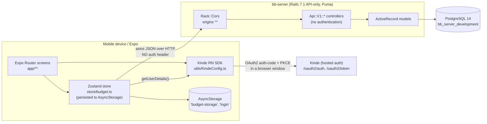
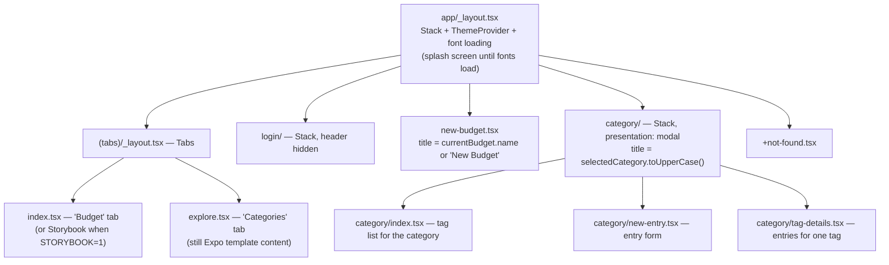
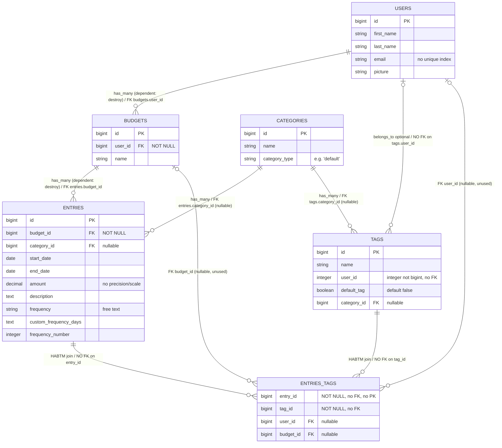
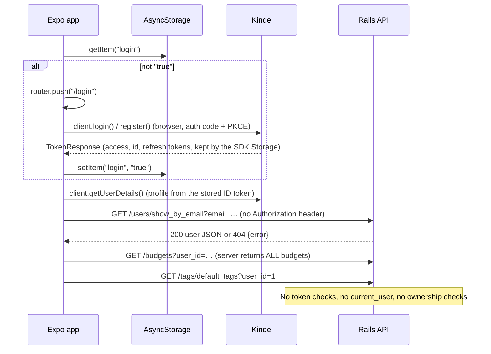
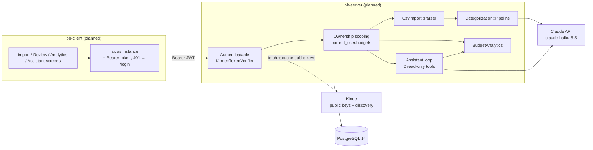

# Budget Buddy — Architecture

Status: **Read-only audit of the existing code**, 2026-11-22.
Snapshot audited: `bb-server` @ branch `chore/copilot-backend-checkpoint` (`0e7f1df`); `bb-client` @ `main` (`81fa7d7`, plus uncommitted Day 0 changes to `.gitignore`/`.env.example`); local development database `bb_server_development`.

Sections 1–8 describe **what existed at the audit** (2026-11-22). Section 9 describes **planned** changes from [`IMPLEMENTATION_PLAN.md`](IMPLEMENTATION_PLAN.md). **What has been built since then is listed in "As-built changes since the audit" below**; where it conflicts with sections 1–8, the newer section wins. A full rewrite of sections 1–8 is planned for the M1 review. The intended end state is in [`product/TARGET_MVP_ARCHITECTURE.md`](product/TARGET_MVP_ARCHITECTURE.md) (a reference, not the as-built record).

## As-built changes since the audit (updated 2026-11-24)

Only what is implemented and tested. Details and test counts are in [`PROGRESS.md`](PROGRESS.md).

**Server (`bb-server`, branch `feature/auth`):**

| Change | Commit | What exists now |
|---|---|---|
| S1a token verifier | `3b54035` | `Kinde::TokenVerifier` + `Kinde::JwksFetcher`: RS256 only; `iss`, `exp`/`nbf`, `sub`, `aud`; JWKS via OIDC discovery (https, issuer host), cached, rotation-aware, fail-closed after 24 h stale. |
| DB0 fresh dev database | `919d8b7` | The development database name comes from `BB_DEV_DATABASE`, default `bb_server_mvp_development` (synthetic data only). The pre-MVP `bb_server_development` is kept, unmigrated at `20250419232612`. |
| S1b authentication | `654dfc9` | `Authenticatable` (in `ApplicationController`): every `api/v1` request needs `Authorization: Bearer <Kinde access token>`, verified by one memoized verifier with the **audience required**. 401 `{"error":"unauthorized"}`; Kinde keys unavailable → 503. `/up` is public. Boot fails without `KINDE_ISSUER_URL` / `KINDE_AUDIENCE`. **Replaces §6.1/§6.3's "no server-side authentication".** |
| S2 users | `c9a5ffa` | `users.kinde_id` (unique), unique `lower(email)`; `financial_profiles` (one per user; `week_starts_on` wday, default 1 = Monday; IANA `time_zone`; pay-pattern fields; jsonb answers). `GET /api/v1/me` finds, links (SR-1: only on Kinde `email_verified == true`, server-fetched; otherwise 409) or creates the user and its profile. `/users` endpoints act on the caller's own record; `POST /users` provisions like `/me`. |
| S3 ownership | `2c92400` | All lookups go through `current_user` (budgets; entries via the caller's budgets; tags = global defaults + own). Other users' records → 404; invalid references → 422; category and default-tag writes → 403; no user row → 403. CORS = exact `CORS_ORIGINS` (dev: local Expo web ports; `*` fails boot). **Replaces §1's `origins '*'`.** `authorization` filtered from logs. |
| DM-2 (accounts) | `6adcb49` | `accounts` (owned by the user; kind and purpose from fixed lists; unique name per user ignoring case; optional opening balance + date as a pair; `archived_at`). `GET/POST/PATCH/DELETE /api/v1/accounts`, scoped through `current_user.accounts`; DELETE archives; archived accounts are read-only. |
| T1 (transactions tables) | `eae5d14` | `imports` (per account; status, counts, `row_errors` as line + code only, no file stored) and `transactions` (per account; signed `amount` decimal(12,2), never zero; `normalized_description`, `base_key` SHA-256, `occurrence`, `external_id`; nullable `category_id` that must be on the active list and agree with `categorization_source`; `confidence`, `needs_review`). Unique `(account_id, base_key, occurrence)`, partial unique `(account_id, external_id)`, index `(account_id, posted_on)`; a composite FK keeps a transaction's import in the same account. Reached via `current_user.transactions` / `.imports` (through accounts). No endpoints yet (I2). |
| I1 (CSV parser) | `f9ac479` | `CsvImport::Parser.parse(content)` for the one generic format (§2.4): no database access. Returns rows (`line`, `posted_on`, `amount` BigDecimal, `description`, `external_id`, `balance`), row `errors` and `warnings` as `{line, code}` only, `extra_columns`, `has_transaction_id`, or a whole-file `file_error` (`empty_file`, `no_rows`, `missing_headers`, `duplicate_headers`, `malformed_csv`, `invalid_encoding`, `file_too_large` > 2 MB, `too_many_rows` > 10,000). Dates: `YYYY-MM-DD` or month-first `M/D/YYYY` (PO-18 change). Line = CSV record number, header = 1. Template + `generic-notes.txt`: `bb-server/public/csv-templates/generic.csv`. |
| I2 (import endpoint) | `1be4c0b` | `POST /api/v1/accounts/:account_id/imports` (multipart `file`; `.csv` + CSV-like content type, ≤ 2 MB; archived account → 422) via `CsvImport::Importer`: parse in memory, discard the file, one `imports` row + `INSERT … ON CONFLICT DO NOTHING` in batches of 1,000, in one DB transaction. Rows with a bank `transaction_id` are keyed on it; others on content + in-file occurrence. Rejected files → 422 `{error, message}`, nothing stored. `GET /api/v1/transactions` (filters `account_id`, `from`, `to`, `category` slug or `none`, `needs_review`; `page`/`per_page` ≤ 200; money as strings), `PATCH /transactions/:id` (category slug only → source `user`; Transfers reserved), `DELETE /transactions/:id` (hard delete). Archived accounts' transactions are read-only. `GET /accounts` and `/accounts/:id` add computed `data_through`. 10,000 rows: 1.8 s locally. |
| AI1 (rules-based categorization) | `a784301` | `merchant_rules` (user, `merchant_key`, category, `hits`, `last_used_at`; unique `(user_id, merchant_key)`). `Categorization::Pipeline` runs after every import on that import's uncategorized rows: merchant memory (source `memory`) → `KeywordRules` (18 rules over ~150 merchant words, sign-aware; source `rule`) → AI step (`DisabledAi` until AI2; answers below 0.6 confidence, unknown slugs or Transfers → review). Leftovers get `needs_review = true`. Only rows still at source `none` are written; categories come from the active list, never Transfers. `MerchantKey` = normalized description minus card-processor prefixes (`SQ *`, `TST*`, `POS PURCHASE`…). Import response adds `categorized: {memory, rule, ai, needs_review}`. AI step items: `index`, `merchant`, `amount`, `account_purpose`. |
| AI3 (learning from corrections) | `6c96f1c` | `PATCH /transactions/:id` with a category upserts the caller's `merchant_rules` row for that merchant key (one atomic `INSERT … ON CONFLICT`; same category keeps `hits`, a new one replaces it and restarts `hits`), in the same DB transaction as the change. The same request also updates the caller's other rows from that merchant that are `needs_review = true`, not user-chosen and in active accounts (source `memory`; response `also_updated: N`). Clearing a row whose source is `memory` deletes that merchant rule; clearing other rows, refused changes and other users' transactions leave memory alone. The next import of that merchant is categorized from memory with no AI call. |
| DEMO-G (demo data generator) | `91bc30e` | `Demo::Generator` (`lib/demo/`): fixed seed + end date → byte-identical generic-format CSVs for 24 months of one fictional persona: `checking.csv`, `savings.csv`, `venmo.csv` (M/D/YYYY dates), `checking-overlap.csv` (last 60 days again), `malformed.csv` (3 bad rows + 1 zero). Transfer pairs and decoys are recorded for TR1; `golden.csv` = 300 labelled rows for EV1. `Demo::Seeder` / `bin/rails demo:seed [USER_EMAIL=]` imports them through `CsvImport::Importer` (development/test only). |
| AI-0 (Claude connection) | `0f2ec38` | Gem `anthropic` 2.14. `AnthropicClient#structured` (structured output via `output_config.format`, effort `low`, timeout 30 s, 2 retries): model ids from `ANTHROPIC_CATEGORIZATION_MODEL` / `ANTHROPIC_ASSISTANT_MODEL` (default `claude-haiku-5-5`). Logs one `[ai]` line per call: feature, model, token counts, duration, outcome; never the key, prompt, answer or error message. Typed errors `Refused`, `BadOutput`, `Unavailable`, `NotConfigured`; refuses to build a real client in the test environment. `script/anthropic_smoke.rb` (unmetered, manual). |
| S4-min (rate limit and AI cost cap) | `78f73e0` | `ai_usage` (user, UTC `day`, `feature` categorize/onboarding/plan/assistant, `requests`, `input_tokens`, `output_tokens`; unique per user/day/feature). `AiBudget`: `check!` before and `record!` after **every** `AnthropicClient` call (a metered call must name the user); cap `AI_DAILY_TOKEN_CAP` tokens/user/day (default 200,000). `AiRateLimit`: 20 `POST /transactions/categorize` per user per hour, after authentication. Rack::Attack: per-IP limit on `/api/*` (`API_REQUESTS_PER_IP_PER_5MIN`, default 300). All 429s are JSON with `Retry-After` where applicable. `POST /api/v1/transactions/categorize` re-runs the pipeline on rows waiting for review. If the AI step fails or the cap is hit, rows go to review and imports still succeed. Memory stores are per process (one server). |
| AI2 (Claude categorization) | uncommitted | `Categorization::ClaudeCategorizer` is the pipeline's AI step whenever `ANTHROPIC_API_KEY` is set (not in tests). Sends `index`, `merchant`, `amount`, `account_purpose` only (no dates), as JSON data; the output schema's `category_slug` enum is the allowlist (active spending + Income, never Transfers); the pipeline re-checks slug, index and 0.6–1 confidence. ≤ 100 rows per run in batches of 50. New column `transactions.ai_attempted_at`: set when Claude answered (incl. refusal / cut-off → review) or the user cleared the row; left nil on 429 / network / daily cap, so the next run resumes. Summary adds `sent_to_ai`, `remaining`; `POST /transactions/categorize` returns `{processed, remaining, categorized}`; the import response's `categorized.remaining` tells the client whether to call it. Before rules and Claude (after memory), `Categorization::TransferCheck` sends transfer-like rows (`TRANSFER TO/FROM`, `CASH OUT`, another own account's name) straight to review with `ai_attempted_at` set, so they never reach Claude; the prompt's "own-account transfers → confidence 0.2" stays as a backup. Summary adds `transfer_like`. |
| UP1 (Expo upgrade): Kinde shared-module workaround | `7cc9083` (SDK 54: `expo-modules-core 3.0.30`, `expo-secure-store ~15.0.8`) | `@kinde-oss/react-native-sdk-0-7x@1.3.1` declares its own old Expo native modules (`expo-web-browser@12.8.2`, `expo-constants@^14`, `expo-modules-core@^1.2`, `expo-secure-store@^12`), which would install a second, mismatched copy of Expo's native core. `bb-client/package.json` `overrides` force Kinde to use the app's SDK-matched copies (`$expo-constants`, `$expo-web-browser`, and pinned `expo-modules-core` / `expo-secure-store` versions, updated at each SDK step); `npm ls` shows one copy of each. Kinde 2.x (which drops these dependencies but moves `audience` to login) is deferred to v1 (plan §11). **Install with npm only:** Yarn, pnpm and Bun ignore npm `overrides`, which brings back Kinde's old `expo-constants` 14 (seen in an EAS preview job: `uuidv4 is not a function`). |
| UP1 (Expo upgrade) | `7cc9083` (`chore/expo-sdk-54`) | Client on **Expo SDK 54**: React 19.1, React Native 0.81.5 with the **New Architecture on**, Expo Router 6, React Navigation 7, Reanimated 4.1 (+ `react-native-worklets`), **NativeWind 4.2** (Tailwind 3.4; `global.css`, `withNativeWind` in Metro, `jsxImportSource` in Babel; no `styled()`), `jest-expo` 54. Babel `unstable_transformImportMeta` (Zustand's ESM build on Hermes). **Storybook removed.** `react-native-modal-datetime-picker` kept. TypeScript baseline 48. iOS development build needs Xcode 16.1+ (installed 16.4); SDK 55+ needs Xcode 26 (v1). |
| LG1 (new tab layout) | `6868ae8` (`chore/expo-sdk-54`) | Tabs **Home / Plan / Activity / Coach** (`app/(tabs)/`); Activity is a stack (`app/(tabs)/activity/`) for C2/C2b. Home, Plan, Coach and the Activity root are Forest Floor placeholders (`components/brand/PlaceholderScreen.tsx`); Home has Log out. **Brand tokens** in `constants/Theme.ts` (colours, fonts, radii, 44-pt touch target); fonts Bricolage Grotesque 700 + Inter 400/500/600 via `@expo-google-fonts/*`, loaded in `app/_layout.tsx` (SUSE kept for the legacy login screen). Navigation uses a light Forest Floor theme (no dark navigation theme). **`hooks/useSession.ts`:** `useSessionBootstrap` (in the tab layout: signed-out → `/login`; signed-in → `fetchUserData` → `GET /me`, so C0's "always /me" holds whichever tab shows) and `useLogout`. **Legacy UI frozen:** Budget/Categories tabs, `category/` stack and `new-budget` moved unchanged to `legacy/app/` (Expo Router makes every `app/` file a route), unreachable; legacy store code untouched; four legacy links cast to `Href` with a note. Root header no longer shows `currentBudget.name`. |
| C2 (accounts and import screens) | client `1cb736a`, server `f096f8a` | Activity stack screens per `docs/product/SCREENS_ACTIVITY.md` §1–4: **Activity** root (`activity/index.tsx`: Import button, "N accounts · data through", "N to review" card, account filter chips, transactions grouped by day with paging, pull to refresh, empty state), **Accounts** (cards with kind · purpose, "N transactions · through", freshness chip, Import CSV, Add account, archived count, template link), **Add account** (name with the server's 422 message inline, type and purpose chips, "Save and import CSV" / "Save without importing"), **Import** (account picker, `expo-document-picker`, upload, then `POST /transactions/categorize` until `remaining = 0` or a 429 stops it, result card with categorized / to review / duplicates / unreadable rows in plain words, "Some transactions will be categorized later"), **Review** placeholder (C2b). Helpers: `utils/activityApi.ts` (typed calls through `api`), `utils/format.ts` (money, dates, freshness, grouping), `utils/importMessages.ts`, `utils/accountLabels.ts`, `hooks/useAsync.ts`, `components/brand/ui.tsx`. **Server:** accounts JSON adds `transaction_count`; `GET /transactions?import_id=` (another user's import → 404). |
| CI1 (GitHub Actions CI) | server `e0d6058`, `d6ea619`, `c026592`; client `5fbc6d0` | `.github/workflows/ci.yml` in each repo, on push and pull_request, no secrets. **Server:** Ruby from `.ruby-version` (3.3.0, bundler cache), Postgres 17 service, `DATABASE_URL`, `bin/rails db:test:prepare` + `bin/rails test`. **Client:** Node 22, `npm ci`, `npm run tsc:check` (fails above the TS0 baseline, 48) and `npm run test:ci`. The I2 10,000-row timing limit is checked only with `PERF=1` (flaky under parallel workers / CI). Nothing calls Claude (the client never does; `AnthropicClient` refuses real calls in test). |
| TR1 (transfer matching) | server `317e9d1`, merged to `main` | `transfer_links` (user, outflow/inflow transaction, `status` suggested/confirmed/rejected, `days_apart` 0–3, `previous_state` jsonb, `confirmed_at`, `rejected_at`; unique ordered pair over all statuses so a rejected pair is never re-suggested; partial unique on each row while suggested/confirmed). `TransferMatcher` runs after every import over ±3 days of its range: different accounts, equal and opposite amounts, ≤ 3 days; candidates sorted by gap, then earliest dates, then lowest ids, taken greedily; `INSERT … ON CONFLICT DO NOTHING`; idempotent. `GET /transfer_links?status=`, `POST /transfer_links/:id/confirm` (both rows → Transfers, source `transfer`, out of review; previous `category_id`/`categorization_source`/`confidence`/`needs_review` stored), `POST …/reject`, `DELETE /transfer_links/:id` (Undo: confirmed → rows restored if still Transfers, back to suggested; rejected → suggested; 409 if a row has since joined another pair or nothing to undo). A transaction in any link can't be deleted (422); AI3 corrections skip rows in active pairs. `Demo::Reset` deletes the demo user's links first. **Differences from handoff #05 §A, approved by the PO (2026-11-25):** (1) confirm stores categorization source and confidence as well, so Undo restores a row exactly; (2) undoing a reject is a 409 if a row has since joined another pair; (3) Undo of a confirm skips rows changed since (same rule as the category Undo); (4) transactions in any pair can't be deleted; (5) merchant corrections skip rows in a pair. |
| C2b (review and transfer screens) | server `2dfcfe0`, client `583c50e`, merged to `main` | **Server:** `transactions.suggested_category_id` (Claude's < 0.6 pick; CHECK: never with a category; cleared on every categorization; stored/restored by transfer confirm/undo); `category_corrections` + `Categorization::Correction` (PATCH returns `correction_id`; `POST /category_corrections/:id/undo` restores rows still at the corrected category and the merchant rule, 409 on a second undo); `GET /transactions/review_groups` via `Categorization::Review` (waiting rows in active accounts not in a suggested pair, grouped by merchant key, suggestion + 2 alternatives, shared `remaining` count); transaction JSON adds `suggested_category`, `transfer_suggested`. **Client:** `activity/review.tsx` (merchant cards, "<Name>?" suggestion chip then alternatives then More…, collapse to "<Category> · also updated N others" + Undo, "All caught up" with the mascot), `activity/transfers.tsx` (pair cards, Confirm / Not a transfer, outcome + Undo), Activity: transfers tile, Review count, row chips Transfer? / <Suggestion>? / Needs review. `components/activity/` (`ReviewGroupCard`, `TransferPairCard`, `rowChip`), `components/brand/Mascot.tsx` (`react-native-svg` `SvgXml`, markup synced with `assets/brand/mascot.svg` by a test). |
| EV1 (categorization eval) | server `9deac5c` + hard set uncommitted (`feature/categorization-eval`) | `Evals::Categorization` (`lib/evals/`): a separate eval user (wiped first, so merchant memory is empty) with one account per purpose; the 300-row golden set from `Demo::Generator#golden` inserted as transactions; the real `Categorization::Pipeline` run until nothing is left for Claude (daily cap applies). **Labels are the generator's own categories, never the pipeline's output.** `Evals::CategorizationReport`: auto-categorized accuracy (headline), accuracy by stage, review rate, suggestion accuracy, per category, mistakes, transfer critical errors (must be 0), tokens and cost, limitations. **Hard set:** `lib/evals/golden_hard.yml` (80 hand-written rows with labels: unknown merchants, messy descriptions, person-to-person, refunds, ambiguous, transfers incl. two the transfer check misses), loaded by `Evals::GoldenSets`; keyword rules frozen at fingerprint `9efd9329adcaf092` (the report states whether they changed since). `Pipeline.call(keyword_rules: false)` for the Claude-only run (transfer check stays on). `bin/rails eval:categorization` (development only, needs `ANTHROPIC_API_KEY`) runs easy set, hard set and hard set Claude-only into one report, `docs/evals/categorization-<date>.md`. Manual only, never in CI. |
| DM-1 (new category list) | `389458b` | `categories` gains `slug` (unique), `kind` (spending/income/transfer/legacy), `active`, `position`, `need_want`, `fixed_variable`, `recurrence_label`, with CHECK constraints. Seeds add 17 spending categories + Income + Transfers. The 5 old rows are `legacy`/inactive (ids 1–5 in the MVP database). `GET /categories` returns the active list; `categories#default` still returns only legacy rows. |

Tests: **197 runs, 0 failures** (from 70 at the audit), including the S1b authentication matrix, SR-1, and the shared ownership matrix (`test/controllers/ownership_matrix_test.rb`).

**Client (`bb-client`, branch `feature/ios-dev-build`, `6a61d74`):** the Kinde client requests the API audience (`EXPO_PUBLIC_KINDE_AUDIENCE`). Physical-iPhone development uses a local Expo **development build** (generated `ios/`, gitignored; Kinde redirects `budget-buddy-scheme://`), because Expo Go no longer supports SDK 51. **The client does not send the access token yet (C0)**, so with S1b in place its API calls return 401.

**Labels used in this document**
- **✅ Verified**: read in source, or seen when running a read-only command such as `tsc`, `jest`, `psql` or `bin/rails test`.
- **⚠️ Uncertain**: inferred from framework defaults or library source, but not exercised end to end.
- **🔜 Planned**: not implemented.

---

## 1. System overview

Budget Buddy is a mobile budgeting app made of two independent projects, each in its own git repository:

| Project | Repo | Role |
|---|---|---|
| `bb-client/` | `budget-buddy-native` (GitHub) | Expo / React Native app (iOS, Android, web via Metro) |
| `bb-server/` | `budget-buddy-server` (GitHub) | Rails 7.1 API-only JSON backend on PostgreSQL |

The project root (`budget-buddy-app/`) is **not** a git repository. `docs/` and `CLAUDE.md` aren't tracked by any repo yet.

**How the two talk to each other (✅):** the client calls the Rails API directly over HTTP with **axios**, from inside the Zustand store (`store/budget.ts`). The base URL comes from `EXPO_PUBLIC_API_BASE_URL`, which must include the `/api/v1` prefix. Requests are plain JSON, with **no `Authorization` header and no cookies**. Identity is established only between the app and **Kinde** (hosted login in a browser window via the Kinde React Native SDK); the Rails API never sees it.

---

## 2. Technology stack

### 2.1 Client (`bb-client/package.json`, ✅)

| Area | Package (version range) | Notes |
|---|---|---|
| Runtime | `expo ~51.0.28`, `react-native 0.74.5`, `react 18.2.0` | Expo SDK 51 |
| Routing | `expo-router ~3.5.23` | File-based routing, `typedRoutes` experiment enabled |
| State | `zustand ^4.5.5` | `persist` middleware + AsyncStorage |
| HTTP | `axios ^1.7.6` | Called directly inside store actions. There's no shared axios instance. |
| Auth | `@kinde-oss/react-native-sdk-0-7x ^1.3.1` (installed 1.3.1) | See §6 |
| Storage | `@react-native-async-storage/async-storage 1.23.1` | |
| Styling | `nativewind ^2.0.11` + `tailwindcss 3.3.2`, plus `StyleSheet` | `className` props via the `nativewind/babel` plugin |
| UI and inputs | `expo-linear-gradient`, `@react-native-picker/picker`, `@react-native-community/datetimepicker`, `react-native-modal(-datetime-picker)`, `react-native-pie-chart ^3.0.2`, `@expo/vector-icons` | |
| Dev tools | `@storybook/react-native ^7.6.20` (+ on-device addons), `jest ^29.7.0`, `jest-expo ~51.0.3`, `@testing-library/react-native ^12.7.2`, `typescript ~5.3.3` | See §7 |
| **Apparently unused** | `react-native-config`, `react-native-dotenv`, `@heroicons/react`, `dotenv` | Not imported by any source file. `dotenv` is imported in `app.config.ts`, but `config()` is never called. |

### 2.2 Server (`bb-server/Gemfile`, ✅)

| Area | Gem | Notes |
|---|---|---|
| Framework | `rails ~> 7.1.4` | `config.api_only = true`, `load_defaults 7.1` |
| Ruby | `3.3.0` (`.ruby-version`, Gemfile, Dockerfile) | |
| Database | `pg ~> 1.1` | Local server is **PostgreSQL 14.25** (✅ `show server_version`) |
| Web server | `puma >= 5.0` | |
| CORS | `rack-cors` | |
| Env | `dotenv-rails` | Loads `bb-server/.env` (the Kinde variables there aren't read by any code, ✅ grep) |
| Other | `bcrypt ~> 3.1.7` (not used by any model), `bootsnap`, `tzinfo-data`, `debug` (dev/test) | |
| **Missing** | No JSON serializer (jbuilder is commented out), no auth/JWT gem, no background-job backend, no HTTP client, **no `redis` gem**, even though `cable.yml` uses Redis in production | |

---

## 3. Frontend architecture (`bb-client`)

### 3.1 Navigation (Expo Router, ✅)

| Screen | What it does today (✅) |
|---|---|
| `(tabs)/index.tsx` (Home) | On mount, reads AsyncStorage key `login`; if it's not `"true"`, goes to `/login`. Renders `Header` (which triggers `fetchUserData`), then either `GetStarted` + "Create New Budget" (no budgets) or `CircularChart` + `CategoryList`, plus Logout. When `extra.storybookEnabled` is set, the module exports the Storybook UI instead of this screen. |
| `(tabs)/explore.tsx` | Unchanged Expo starter template ("This app includes example code…") under the tab labelled **Categories**. |
| `login/index.tsx` | `client.login()` / `client.register()` → on a token, stores `login="true"` → `router.replace("/(tabs)")`. |
| `new-budget.tsx` | Text input plus `CategoryList`. **`handleSubmit` is empty and the "Finish" button has no `onPress`**, so naming or creating a budget here does nothing. |
| `category/index.tsx` | Picks one of the per-category tag arrays from the store and renders a `CategoryTag` for each. |
| `category/new-entry.tsx` | Form (title, amount, start/end date, interval picker or custom N + unit) → `addEntry(entryData, tagId)`. **Saving a custom interval throws a `ReferenceError`** because `customIntervalDays` is never declared. |
| `category/tag-details.tsx` | Filters `entries[selectedCategory]` by `categoryTag.id` and renders `EntryDetails`. |

### 3.2 Components (✅)
- **Feature components:** `Header` (avatar and name; calls `fetchUserData` on mount), `Categories/CategoryList` (gradient buttons that call `setCategory` then push `/category`; **shows 4 of the 5 categories, Miscellaneous is missing**), `CategoryTags/CategoryTag` (tag card with "Add Entry" / "View Details" and an entry preview list), `Entries/EntryPreview`, `Entries/EntryDetails`, `CircularChart` (**static placeholder**: one grey slice and "N/A", no data), `GetStarted`, `DatePicker`.
- **Template leftovers:** `ThemedText`, `ThemedView`, `ParallaxScrollView`, `Collapsible`, `ExternalLink`, `navigation/TabBarIcon`, `Button/Button` (Storybook demo).
- **Broken imports** (✅ `tsc`): `app/(tabs)/index.tsx` imports `@/components/HelloWave`, which doesn't exist, and `Entries/EntryPreview.tsx` and `Entries/EntryDetails.tsx` import `Entry` from `@/types`, which doesn't exist either (the type lives in `utils/types.ts`). ⚠️ Metro can probably still bundle, because the Babel TypeScript transform removes imports that are unused or used only as types. That wasn't exercised here.

### 3.3 State management (Zustand, ✅)

There's a single store, `useBudgetStore` in `store/budget.ts`, wrapped in `persist` with `createJSONStorage(() => AsyncStorage)` under the key **`budget-storage`**. It holds both data and the API-calling logic.

| State | Contents |
|---|---|
| `user` | `{family_name, given_name, email, picture, id?}`, using Kinde's field names, filled from the backend user |
| `budgets`, `currentBudget` | Budget list; the newest becomes `currentBudget` |
| `selectedCategory` | A display string from the `Category` enum (e.g. `"Savings & \n Goals"`) |
| `tags`, `incomeTags`, `expenseTags`, `savingsTags`, `miscTags`, `strategyTags` | Default tags split by **hardcoded category IDs 6–10** |
| `entries` | `{ [categoryDisplayString]: Entry[] }` |

| Action | API calls (✅) |
|---|---|
| `fetchUserData` | If `entries` is empty: `GET /entries/entries_by_budget_with_default_categories` (result never used). Then, if the user and tags aren't cached: Kinde `getUserDetails()` → `GET /users/show_by_email?email=` → for an existing user: `GET /budgets?user_id=` (**the server ignores `user_id` and returns every budget**) + `GET /tags/default_tags?user_id=1`. The "create user" branch (`POST /users`) is never reached (see §6.3). |
| `setCategory` | `fetchCategoryEntries(category_id)` → `GET /entries/entries_by_budget_with_default_categories?budget_id=&category_id=`; may call `GET /tags/default_tags?user_id=1`; otherwise **replaces `tags` with `CategoryTags[category]`, a list of plain name strings**. |
| `addEntry` | Creates a budget with an empty name if none exists (`POST /budgets`) → `POST /entries` with `tag_ids: [tagId]` → `GET /budgets/:id` (response unused) → appends to `entries[selectedCategory]`. |
| `createNewBudget`, `beginNewBudget`, `clearUser`, `setBudgetName` | `POST /budgets` / `GET /tags/default_tags?user_id=1` / reset state + `AsyncStorage.clear()` / local only |

Shared types and constants are in `utils/types.ts`: the `Category` enum (display strings), `CategoryIdMap` (display → 6..10), `CategoryTags` (a copy of the seed's tag names), and `Entry`/`Budget`/`TagType`. `TagType` is typed as a string, but at runtime tags are API objects (`id`, `name`, `category_id`). This is one source of the 100 `tsc` errors.

### 3.4 API requests (✅)
- `const apiUrl = process.env.EXPO_PUBLIC_API_BASE_URL` at module level in `store/budget.ts`. Every call is a direct `axios.get/post` there. No interceptors, no timeouts, no retries, no auth header.
- Errors are only `console.error`'d. Nothing is shown to the user.

### 3.5 Configuration (✅)
- Both `app.json` and `app.config.ts` exist. `app.config.ts` spreads in the incoming config and repeats the same values, adding `extra.storybookEnabled = (STORYBOOK === "1")`. `package.json` has an `"expo": {"config": "app.config.ts"}` field. ⚠️ That isn't a standard Expo field; Expo CLI picks up `app.config.ts` automatically.
- Client env vars (all `EXPO_PUBLIC_*`, bundled into the app): `API_BASE_URL`, `KINDE_APP_DOMAIN`, `KINDE_ALLOWED_CALLBACK_URL`, `KINDE_LOGOUT_REDIRECT_URL`, `KINDE_CLIENT_ID`.

---

## 4. Backend architecture (`bb-server`)

### 4.1 Layers (✅)
- **Controllers:** `app/controllers/api/v1/{budgets,categories,entries,tags,users}_controller.rb`, all inheriting from an **empty** `ApplicationController < ActionController::API`.
- **Models:** `User`, `Budget`, `Entry`, `Tag`, `Category`, `EntriesTag` (§5).
- **Services:** **none.** There's no `app/services`, and `lib/` has only an empty `tasks/`. All logic lives in controllers and in one query in `EntriesController`.
- **Unused framework pieces:** `ApplicationCable` (empty connection and channel), `ApplicationJob`, `ApplicationMailer`.
- **Initializers:** `cors.rb` (`origins '*'`, all methods), `filter_parameter_logging.rb` (Rails default list), `inflections.rb`.

### 4.2 Routes (`config/routes.rb`, ✅)

All routes are under `/api/v1`. Because the app is API-only, `resources` doesn't generate `new` or `edit` routes.

| Resource | Standard actions | Extra routes |
|---|---|---|
| `entries` | index, show, create, update, destroy | `GET /entries/entries_by_budget_with_default_categories?budget_id=&category_id=` |
| `tags` | index, show, create, update, destroy | `GET /tags/default_tags[?user_id=]` |
| `budgets` | index, show, create, update, destroy | — |
| `users` | index, show, create, update, destroy | `GET /users/show_by_email?email=` |
| `categories` | index, show, create, update, destroy | `GET /categories/default` |
| health | `GET /up` → `rails/health#show` | — |

### 4.3 Request and response patterns (✅ unless marked)
- **Lookups:** `Model.find(params[:id])` in a `before_action :set_*` (budgets, categories, entries, users) or inline (tags). A missing record → 404 through Rails' default `RecordNotFound` handling (⚠️ framework default, not tested here).
- **Rendering:** `render json: model`, using ActiveRecord's default `as_json`, so **every column** is returned (including `users.email`). Only entries add associations: `as_json(include: :tags)` on create and update, and `include: { tags: { only: [:id, :name, :category_id] } }` on the category query.
- **Error formats are inconsistent:** `render json: model.errors` (field → messages hash; budgets, categories, tags, users update) vs `{ errors: [full_messages] }` (entries) vs `{ error: "…" }` (users `show_by_email` 404, duplicate-email 422).
- **Status codes:** `201` on create (categories and users also set `Location: api_v1_*_url`), `422` on validation errors, and `destroy!` returns `204 No Content`.
- **Params:** `params.require(:model).permit(...)`. ⚠️ Rails 7 wraps JSON params by default, so the client's unwrapped `POST /users` body is wrapped under `user` automatically. `picture` is then silently dropped, because it isn't permitted.
- **Permitted fields that matter for security:**

| Controller | Permitted | Concern |
|---|---|---|
| budgets | `user_id, name` | The client picks the owner |
| tags | `name, category_id, user_id, default_tag` | The client picks the owner and can create global "default" tags |
| categories | `name, category_type` | The client can create `default` categories |
| entries | `budget_id, start_date, amount, description, frequency, custom_frequency_days, category_id, frequency_number, end_date, tag_ids[]` | Any budget, any tag IDs |
| users | `first_name, last_name, email` | — |

- **Notable logic:**
  - `EntriesController#entries_by_budget_with_default_categories`: `Entry.joins(:tags).where(budget_id:).where(tags: {category_id:}).distinct.includes(:tags)`. It filters on the **tags'** category and ignores `entries.category_id`, so entries with no tags are excluded.
  - `EntriesController#sync_tags`: `@entry.tags = Tag.where(id: tag_ids)`, which ignores unknown IDs and doesn't check who owns the tag or what category it's in.
  - `UsersController#create`: returns 422 if the email already exists.
  - `TagsController#default_tags`: `Tag.where(default_tag: true)`, filtered by `user_id` only if the param is sent.
  - `CategoriesController#default`: `Category.where(category_type: 'default')`.

---

## 5. Data model (PostgreSQL + ActiveRecord)

Source: `db/schema.rb` (version `2025_04_19_232612`, 17 migrations), the model files, and live `pg_constraint`/`pg_indexes` queries (✅).

### 5.1 Model associations and validations (✅)

| Model | Associations | Validations |
|---|---|---|
| `User` | `has_many :budgets, dependent: :destroy`; `has_many :entries_tags, dependent: :destroy` | `first_name`, `last_name`, `email` present; `email` unique (**app-level only**) |
| `Budget` | `belongs_to :user`; `has_many :entries, dependent: :destroy`; `has_many :tags, through: :entries` | — (an `associate_default_tags` callback exists but is commented out) |
| `Entry` | `belongs_to :budget`; `belongs_to :category, optional: true`; `has_and_belongs_to_many :tags` | `amount` numeric, `allow_nil` |
| `Tag` | `belongs_to :user, optional: true`; `belongs_to :category, optional: true`; `has_many :entries_tags`; `has_and_belongs_to_many :entries` | `name` present |
| `Category` | `has_many :tags`; `has_many :entries` | `name` present |
| `EntriesTag` | `belongs_to :entry`, `:tag`, `:user (optional)` | — (a model on a table with **no primary key**) |

### 5.2 Constraints in the database (✅ live)
- **Primary keys:** every table except `entries_tags`.
- **Foreign keys:** `budgets.user_id → users`, `entries.budget_id → budgets`, `entries.category_id → categories`, `tags.category_id → categories`, `entries_tags.user_id → users`, `entries_tags.budget_id → budgets`.
- **Missing foreign keys:** `entries_tags.entry_id`, `entries_tags.tag_id`, `tags.user_id`.
- **Unique constraints:** none, apart from primary keys. In particular there's none on `users.email`, `tags (…name)` or `entries_tags (entry_id, tag_id)`.
- **NOT NULL** (besides timestamps): `budgets.user_id`, `entries.budget_id`, `entries_tags.entry_id`, `entries_tags.tag_id`.
- **Indexes:** on every foreign-key column listed above, plus `tags.user_id`, `entries_tags.entry_id` and `entries_tags.tag_id`.

### 5.3 Current development data (✅ read-only queries)

| Fact | Value |
|---|---|
| Rows | users 2, budgets 1, categories 5, tags 38, entries 44, entries_tags 76 |
| Category IDs | 6 Expense, 7 Income, 8 Savings & Goals, 9 Miscellaneous, 10 Budgeting Strategy |
| Default tags | all 38 have `default_tag = true` and **`user_id = 1`** (the current seeds would create them with `user_id = nil`) |
| **Orphaned join rows** | **33 of the 76 `entries_tags` rows point at entries that no longer exist** (0 point at missing tags). This is possible because there's no foreign key on `entry_id`. |
| Duplicates | 0 duplicate `(entry_id, tag_id)` pairs, 0 duplicate tags, 0 duplicate emails (case-insensitive) |
| Entries | 0 without `category_id`, 0 whose tag category doesn't match, 1 with no tags |
| `entries.frequency` values | `Every week` 18, `""` 15, `Every month` 9, `Every year` 2 |
| `entries_tags.user_id` / `budget_id` filled in | 1 row each (the tag link (HABTM) doesn't fill them) |

---

## 6. Authentication and authorization

### 6.1 Current flow (✅)

- **Kinde SDK details (✅ read from the installed SDK 1.3.1):**
  - `new KindeSDK(issuer, redirectUri, clientId, logoutRedirectUri, scope?, additionalParameters?)`. The default scope is `openid profile email offline`.
  - `additionalParameters` accepts `audience`, but **`utils/KindeConfig.ts` passes only the first four arguments, so no audience is requested.**
  - `client.getToken()` returns the stored `TokenResponse` (`access_token`, `id_token`, `refresh_token`, `expires_in`, …) when the user is authenticated.
  - `isAuthenticated` refreshes the session through the refresh token when the access token has expired.
  - `getUserDetails()` reads the stored user profile.
- **The app's "logged in" state** is just the AsyncStorage flag `login = "true"`. It isn't tied to whether the Kinde token is still valid.
- **Logout:** `client.logout()` → `services.clearAllData()` (`AsyncStorage.clear()`) → `clearUser()`.
- **Server:** `bb-server/.env` defines `KINDE_CLIENT_ID`, `KINDE_CLIENT_SECRET`, `KINDE_REDIRECT_URI` and `KINDE_SITE`, but **no server code reads them**. There's an old local branch `kinde-auth` with no commits that aren't already on `main`.

### 6.2 Authorization
**There isn't any.** Any HTTP client can list, read, change or delete any user, budget, entry, tag or category by ID.

### 6.3 Known security gaps and auth-related bugs (✅)

| # | Gap | Where |
|---|---|---|
| G1 | No authentication on any endpoint | `ApplicationController` |
| G2 | No ownership scoping: `find(params[:id])`, `index` returns whole tables, `/budgets` ignores `user_id` (so the client's `currentBudget` could be **another user's budget** once there are several users) | all controllers, `store/budget.ts` |
| G3 | Every user's email is exposed through `GET /users`, `GET /users/:id` and `GET /users/show_by_email` | `UsersController` |
| G4 | The client chooses ownership: `user_id` on budgets and tags, `default_tag` on tags, `category_type` on categories, and any `budget_id`/`tag_ids` on entries | permitted params (§4.3) |
| G5 | CORS `origins '*'` for all methods | `config/initializers/cors.rb` |
| G6 | "Logged in" is a local flag. The Kinde access token never reaches the API, and no audience is requested. | `login/index.tsx`, `KindeConfig.ts` |
| G7 | No rate or size limits | — |
| G8 | New sign-up never creates a backend user: `show_by_email` returns 404, axios throws, and the `userData.length === 0` branch (meant to call `POST /users`) is never reached. If it were reached, the code reads `given_name`/`family_name` from a response that has `first_name`/`last_name`, and `picture` isn't permitted. | `store/budget.ts`, `UsersController` |
| G9 | `config/master.key` is in a local git stash only (never pushed). `.env` and `master.key` are correctly git-ignored. | `bb-server` git |

---

## 7. Testing and deployment

### 7.1 Server tests (✅)
- Minitest plus fixtures (`test/test_helper.rb`: `parallelize(workers: :number_of_processors)`, `fixtures :all`; with fewer than 50 tests it runs in a single process).
- **Contents:** 20 scaffold integration tests (5 CRUD tests each for Budgets, Entries, Tags and Users controllers). The four model test files contain only the commented-out placeholder; the ActionCable connection test is commented out too. There are no tests for Categories, for any custom endpoint, or for authorization.
- **Status:** on `chore/copilot-backend-checkpoint`: **20 runs, 36 assertions, 0 failures**. On `main`: 20 errors (fixtures reference columns that no longer exist).
- Fixtures: placeholder data (`MyString`); entries have no category; tags have no category or user.

### 7.2 Client tests (✅)
- One snapshot test: `components/__tests__/ThemedText-test.tsx` (`react-test-renderer`).
- **It doesn't run.** `npx jest --ci` fails with "Test Suites: 1 failed", because `nativewind`'s untranspiled code reaches Jest. **`package.json` has no `jest` config**, so there's no `"preset": "jest-expo"` and no `transformIgnorePatterns`. `npm test` runs `jest --watchAll`.
- `npx tsc --noEmit` reports **100 type errors**, most of them in `store/budget.ts` (implicit `any`, store keys typed as strings, the `TagType` mismatch) and NativeWind `className` typings (TS2769 on components).
- Lint: `expo lint` script exists (⚠️ not run as part of this audit).
- Storybook: on-device Storybook 7 (`.storybook/`, stories in `components/**/*.stories.tsx`: Button, CategoryList), turned on with `STORYBOOK=1`.

### 7.3 Deployment configuration (✅)
- **Server:**
  - The Rails 7.1 generated `Dockerfile`: multi-stage, `ruby:3.3.0-slim`, `RAILS_ENV=production`, runs as a non-root `rails` user, `EXPOSE 3000`.
  - The entrypoint runs `bin/rails db:prepare` before `rails server`.
  - `production.rb`: `force_ssl = true`, logs to STDOUT, `config.hosts` not set, Active Storage `:local`.
  - Production database: `bb_server_production`, user `bb_server`, password from `BB_SERVER_DATABASE_PASSWORD` (or `DATABASE_URL`).
  - `cable.yml` production uses Redis, but the `redis` gem isn't installed. ActionCable isn't used, so this has no effect today.
  - Puma: `RAILS_MAX_THREADS` (5), `WEB_CONCURRENCY` (1), `PORT` (3000).
- **Not present:** CI config (`.github/`), hosting or deploy config (Kamal, Fly, Render, Procfile), `config/deploy.yml`.
- **Client:** no `eas.json` or other build or release config. ⚠️ Development appears to run through `expo start` only.

---

## 8. Known limitations and technical debt (✅ unless marked)

1. **No security boundary** between users (§6.3). This is the main blocker for any multi-user use.
2. **Client and server disagree on categories:** the client hardcodes category IDs **6–10** and the display names (`"Expenses"` vs the seed's `Expense`; display strings containing `\n` used as store keys), plus `user_id: 1` for default tags. A freshly seeded database gets different IDs and `user_id = NULL` defaults, so the app breaks.
3. **Seeds and dev data disagree on who owns the default tags** (`user_id 1` vs `nil`). Re-running `db:seed` on the dev database would create 38 duplicate tags.
4. **Weak database integrity:** no foreign keys on `entries_tags.entry_id/tag_id` or `tags.user_id`, no unique constraints, **33 orphaned join rows**, `amount` has no precision, and `tags.user_id` is `integer` while `users.id` is `bigint`.
5. **Two fields for an entry's category:** `entries.category_id` vs the tags' `category_id`. The category endpoint uses the tags, so untagged entries are invisible. `Entry#category` is optional (Copilot change).
6. **`entries_tags` is used two ways:** as a plain HABTM join table, and as an `EntriesTag` model on a table with no primary key, with unused `user_id`/`budget_id` columns. ⚠️ `User#destroy` with `dependent: :destroy` on `entries_tags` would probably fail for a user that has join rows (`ActiveRecord::UnknownPrimaryKey`), but the dev data has only 1 such row and this wasn't exercised.
7. **All logic lives in one large store** (`store/budget.ts`, ~560 lines): API calls, data reshaping and state mixed together. It has dead code (unused requests and many commented blocks) and a signature mismatch (`fetchCategoryEntries`). `setCategory` replaces tag objects with strings.
8. **Unfinished features:** the new-budget screen does nothing, the "Categories" tab is template content, `CircularChart` is a placeholder, Miscellaneous is missing from `CategoryList`, and custom-frequency entries crash.
9. **No transactions, CSV import, analytics or AI** exist yet. `entries` stores *planned* items with free-text `frequency`.
10. **Inconsistent API contracts:** three error formats, every column returned, no serializers, no pagination.
11. **Testing gaps:** no model, authorization or custom-endpoint tests. The client test suite doesn't run, and there are 100 TypeScript errors.
12. **Repository layout:** two repos and an untracked root, so `docs/` and `CLAUDE.md` are in no repo. The checkpoint branch isn't merged.
13. **Unused dependencies:** client `react-native-config`, `react-native-dotenv`, `@heroicons/react`, `dotenv`; server `bcrypt`. The Redis cable adapter is configured without the gem.

---

## 9. Planned architecture (from `IMPLEMENTATION_PLAN.md`, revision 3), 🔜 not implemented

Everything in this section is **planned only**. Task IDs refer to the plan.

| Area | Today (implemented) | Planned |
|---|---|---|
| API authentication | None | `Authorization: Bearer <Kinde access token>`; Rails checks RS256 signature, `iss` and `exp` against Kinde's public keys. The token checker (S1a) treats `aud` as optional; the controller concern (S1b) **requires** `aud`, after the Kinde API audience is set up (KA) |
| Kinde client | No audience requested | `additionalParameters: { audience }` passed to `KindeSDK` (KA) |
| Budget creation | Screen does nothing; budgets created unnamed as a side effect of `addEntry` | Named budget created from `new-budget.tsx` before importing (C-B) |
| Client tests and types | Jest not configured; 100 `tsc` errors | Jest set up for Expo 51 (CT0); error baseline grouped by cause (TS0); no new errors in touched files |
| `entries_tags` integrity | 33 orphaned rows, no foreign keys | **Left as accepted technical debt for the MVP** (plan TD1). No change without approval. |
| Users | `show_by_email`, client-created users | `GET /me`, which finds or creates the user by a new `users.kinde_id`, linking existing users by email. The old endpoints return only the caller's own record (S2). |
| Authorization | None | Every query starts from `current_user`; another user's record → 404; `user_id`, `default_tag` and `category_type` no longer accepted; categories read-only (S3) |
| CORS and limits | `*`, none | `CORS_ORIGINS` allowlist (S3); `rack-attack` plus a daily AI token cap (S4) |
| Categories and tags | Hardcoded IDs, `user_id 1` defaults | `categories.slug` (D-2); global defaults with `user_id NULL`; partial unique indexes for global and user tags; unique `lower(email)` (D-3) |
| Entry categories | Taken from the tags | `entries.category_id` is the source of truth, tags must match it, and the existing endpoint shape stays (D-4) |
| Transactions | — | `imports` + `transactions` tables; duplicate detection that ignores row order, keyed on `(budget_id, base_key, occurrence)` (T1) |
| CSV import | — | Two header formats, processed within the request, 1 MB / 2,000 rows (I1, I2) |
| Analytics | — | `BudgetAnalytics` service: `spending_summary` and `budget_vs_actual`, using `RecurrenceExpander` (AN1, AN2) |
| AI categorization | — | merchant memory → keyword rules → Claude `claude-haiku-5-5` with structured output and a tag allowlist, in pieces of up to 100 rows per call (AI-0…AI3) |
| AI assistant | — | `POST /budgets/:id/assistant/messages`; tool-calling loop in Rails with two read-only tools (`get_spending_summary`, `get_budget_vs_actual`) bound to `current_user` and a checked budget (AS1, AS2) |
| Client | Single store, no auth header | Shared axios instance with the token and 401 handling (C0); slug-based categories plus bug fixes (C1); import, analytics and assistant screens (C2–C4); Jest suite (CT) |

---

## 10. Where the plan and the code disagree (found during this audit)

These are things plan revision 2 either didn't cover or got slightly wrong. **Plan revision 3 (2026-11-22) addresses X1, X3, X5 and X7, and adds the TypeScript baseline for X4:**
- X1 → TD1 (accepted debt)
- X3 → CT0
- X4 → TS0/TD4
- X5 → C-B
- X7 → KA (prerequisite for S1b)

The other findings are still open notes.

| # | Finding | Effect on the plan |
|---|---|---|
| X1 | **33 orphaned `entries_tags` rows**, and no foreign keys on `entry_id`/`tag_id` | Not in the plan. Adding these foreign keys would require **deleting** the orphaned rows first, which conflicts with the "nothing destructive" rule unless you approve it. A reasonable option: leave them for now (they're harmless to queries that join through `entries`) and decide in D-1/D-3. |
| X2 | The plan's D1 says the client's `POST /users` fails partly because the body isn't wrapped | ⚠️ Rails 7 wraps JSON params by default, so the wrapping is fine. The real problems are the 404 → exception path and `picture` being silently dropped. Small correction; S2/C0 are unaffected. |
| X3 | **Client Jest isn't configured** (no `jest-expo` preset, NativeWind transform failure), and the existing test fails | CT assumes a working Jest setup. Add an explicit "configure Jest (preset + `transformIgnorePatterns`)" step to CT, or do it earlier with C0 so C0 can have tests. |
| X4 | **100 TypeScript errors** in the client, plus two imports of modules that don't exist (`@/components/HelloWave`, `@/types`) | Not in the plan. Suggest a target: no **new** `tsc` errors in touched files, and fixing the broken imports in C1. Not fixing all 100 within the sprint. |
| X5 | **The new-budget screen doesn't work** (`handleSubmit` empty, Finish button unwired). Budgets are only created with an empty name, as a side effect of `addEntry`. | The plan's end-to-end flow (Q1: "create budget → import CSV") and the C2 import screen assume a budget exists. Add "wire up the new-budget screen" to C1. |
| X6 | **`GET /budgets?user_id=` ignores `user_id` and returns every budget**, so the client's `currentBudget` could be someone else's | Covered by S3, but it's also a **C0 dependency**: after S3 scopes `/budgets`, the client's call works unchanged. Worth an explicit S3 test. |
| X7 | **Kinde audience isn't requested** (`KindeConfig.ts` passes no `additionalParameters.audience`) | S1b/C0 need: register an API audience in Kinde → pass `{audience}` to the `KindeSDK` constructor → set `KINDE_AUDIENCE` on the server. Until then the server can't require `aud`. S1a's optional `aud` handles this. |
| X8 | Kinde token retrieval confirmed: `client.getToken()` → `TokenResponse.access_token`, which refreshes through the refresh token | Settles the plan's C0 risk "exact SDK call checked first". ⚠️ Still check with a real login. |
| X9 | Rails doesn't log request headers by default, and `filter_parameters` already includes `:token` | The plan's S3 step "filter the Authorization header out of logs" mostly needs **no change**. Keep it as a check (a test or a look at the log), not a code change. |
| X10 | `tags.user_id` is `integer` with no foreign key, while `users.id` is `bigint` | Not in the plan. Changing the column type is low-risk at this data size but is a schema change. Suggest adding it to D-3 as an optional, additive foreign key (0 orphans found). |
| X11 | **Miscellaneous is missing from `CategoryList`**, and the "Categories" tab is Expo template content | Not in the plan. Fold into C1 (show all categories) and Day 3 (use the empty tab, e.g. for Analytics or the Assistant). |
| X12 | `cable.yml` production uses Redis without the `redis` gem, and there's no CI or deploy config | Out of scope for the MVP. Note for DEMO/README ("runs locally; deployment not configured"). |
| X13 | The plan's §1.2 D6 calls the `entries_tags` columns harmless | True for queries, but `User#destroy` (`dependent: :destroy` through the PK-less `EntriesTag`) probably fails for users with join rows (⚠️ not exercised). S2 restricts `users#destroy` to the caller's own record, so the risk is small, but it needs a test, or the association should be removed in a later approved change. |
