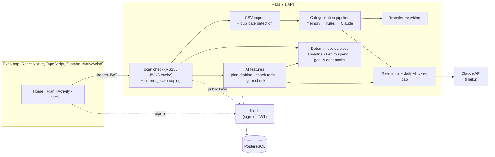

<!--
DRAFT README for the Budget Buddy server repo (the "home" repo). Written by Claude Project on 2026-11-25.
Claude Code: replace every TODO with as-built facts at the end of Milestone 2, keep claims honest (nothing listed as built unless it is),
and remove this comment. Screenshots go in docs/product/screens/ (already there) or docs/readme/.
-->

# Budget Buddy 🐿️

**A personal budgeting app that turns the bank exports you already have into a realistic plan, with an AI coach that helps you keep it, one week at a time.**

Built as a portfolio project to show how to put AI into a real full-stack product *responsibly*: the AI suggests, chooses and explains; **Rails does every calculation**; the user decides.

<!-- TODO: one row of 4 phone screenshots: Home, Activity → Review, Plan, Coach -->

| Rails 7.1 API | PostgreSQL | Expo / React Native (TypeScript) | Claude (Anthropic API) | Kinde auth | GitHub Actions |
|---|---|---|---|---|---|

---

## What it does

1. **Import** CSV exports from each account (checking, savings, Venmo…). Duplicates are skipped, bad rows are reported by line, and the file is never stored.
2. **Categorize** transactions automatically: merchant memory → keyword rules → Claude for the rest. Anything uncertain goes to a quick **Review** screen; one pick teaches the app that merchant, with Undo.
3. **Match transfers** between your own accounts so moving money isn't counted as spending. The app suggests pairs; you confirm or reject.
4. **Plan** (Milestone 2, TODO when built): a short interview, then the coach drafts category budgets, bills and goals from *your* history. Nothing is saved until you approve.
5. **Left to spend this week** on Home, bills due in the next 7 days, and goal progress with debt-payoff maths.
6. **Ask the coach** questions like "How much did I spend on dining out this month?"; every figure in the answer is checked against the app's own numbers.

## How AI is used (and kept in check)

| Feature | What Claude does | What stops it going wrong |
|---|---|---|
| **Categorization** | Picks a category for rows the rules don't know | Structured output limited to the allowed list (never "Transfers"); confidence < 0.6 → Review; transfer-like rows go straight to Review; daily token cap |
| **Plan drafting** (M2) | Chooses gentle options per category and writes short reasons | Rails computes every candidate figure; **model text may not contain digits**; invalid output → one retry → deterministic fallback; nothing saved until the user approves |
| **Onboarding follow-ups** (M2) | Picks ≤ 2 clarifying questions from a fixed menu and words them | Rails owns the answer options; any failure skips them |
| **Coach Q&A** (M2) | Answers questions using 4 **read-only tools** bound to the signed-in user | Tools return existing service output (no maths by the model); a **figure check** rejects any amount not in the tool results (one correction, then a deterministic fallback); "Based on" sources under every answer |

**Privacy:** the model never receives merchant names, transaction descriptions or account names for planning; no financial text in logs; development uses synthetic data only; uploaded files are parsed and discarded.

## Evaluation

The categorization pipeline is measured offline (`bin/rails eval:categorization`, reports in `docs/evals/`). Labels come from the data generator or are hand-written with each row, never from the pipeline itself, and the keyword rules are frozen by fingerprint so they can't be tuned to the test.

| | Easy set (300) | Hard set (80) | Hard set, Claude only |
|---|---|---|---|
| Accuracy of rows categorized **without review** | 100% | **96.8%** | **96.7%** |
| Sent to review | 14.3% | 22.5% | 25.0% |
| Transfers miscategorized as spending/income | **0** | **0** | **0** |

The easy set mostly proves the keyword rules cover the demo data, which is why the hard set exists: unfamiliar merchants, messy descriptions, person-to-person payments and refunds. The metric that matters most is the first row: *a wrong category the user never sees*. A row sent to review only costs a tap.

<!-- TODO (M2): add the coach Q&A eval (EV2): tool-choice accuracy, figure-check pass rate, refusal and prompt-injection results. -->

## Architecture

## Engineering decisions worth discussing

| Decision | Why | Trade-off |
|---|---|---|
| **AI proposes, Rails calculates, user decides** | Money figures must be exact and testable | More Rails code than "let the model do it" |
| Budget-based **Left to spend** instead of balance-based "safe to spend" | CSV exports don't give a reliable balance | Needs a plan before it shows a number |
| Ownership through accounts, not a copied `user_id` | Can't drift out of sync | One extra join |
| Duplicate key = hash + occurrence per account | Re-importing overlapping exports adds nothing, even with identical rows on the same day | Slightly more complex than a unique hash |
| Transfer pairs in their own table with stored previous state | Confirm, reject and Undo are exact and auditable | Another table |
| `category_corrections` table for Undo | Undo restores every affected row *and* the merchant rule, skipping rows changed since | Another table instead of a client-side re-send |
| Follow-ups from a fixed menu; no digits in plan text | AI output stays testable and can't invent numbers | Less conversational (full conversation is v1) |
| Stateless coach, no chat stored server-side | Privacy; simpler | No history across sessions in the MVP |
| Migrations additive and reversible; archive instead of delete | Safe changes on a live schema | Some legacy tables kept until v1 |

## Security

- Every endpoint requires a valid Kinde token (RS256, audience and issuer checked, cached public keys). Existing users are linked only on a **verified** email.
- Every query starts from `current_user`; another user's record returns **404**. A table-driven **ownership-matrix** test covers every endpoint.
- AI tools take no user ID; any ID from the model is looked up through the current user.
- Rate limits (per IP and per feature) and a daily AI token cap; no secrets in the client or the repo.

## Testing and CI

- TODO: server test count, client test count, TypeScript baseline at the end of M2.
- GitHub Actions on every push and pull request: Rails tests against Postgres; client type check (may not exceed the recorded baseline) and Jest tests. CI never calls the AI.
- Every feature merged through a pull request with a green check.
- **AI-assisted development:** built with Claude (product and design in a Claude Project, implementation in Claude Code) under explicit rules: specs approved before building, no commit without review, mutation checks on key tests. Decision log: `docs/product/DESIGN_DECISIONS.md`.

## Running it locally

<!-- TODO (Claude Code): exact commands, verified on a clean machine: Ruby/Node versions, db:create/migrate, demo:reset, Kinde env vars (names only), ANTHROPIC_API_KEY in .env (never committed), starting Rails and Expo, dev build on a phone. -->

## Project docs

| Doc | What's in it |
|---|---|
| `docs/product/PRODUCT_BRIEF.md`, `MVP_SCOPE.md` | The problem, the user, what's in and out |
| `docs/product/DESIGN_DECISIONS.md` | Every decision, who made it, and why |
| `docs/product/SPEC_*.md`, `SCREENS_*.md` | Feature and screen specs |
| `docs/ARCHITECTURE.md` | What's actually built |
| `docs/evals/` | Evaluation reports |

## Roadmap (v1)

Docker Compose; AWS deployment (ECR, least-privilege IAM, GitHub OIDC) under $15/month; web demo on S3 + CloudFront; conversational onboarding; saved coach history; recurring-bill detection; real bank and Venmo CSV formats; Expo SDK 58.
