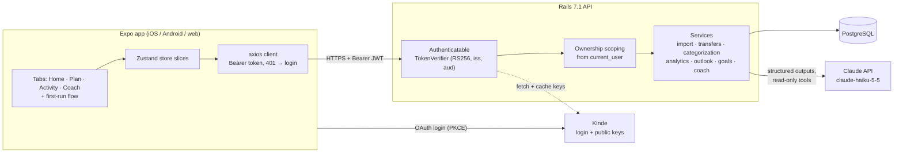
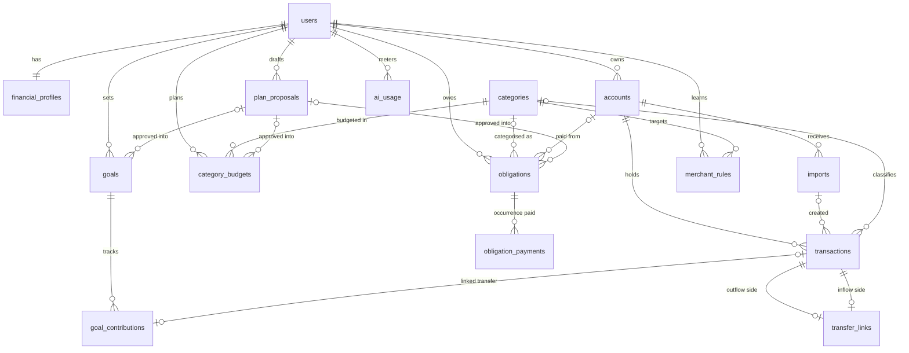

# Budget Buddy — Target MVP Architecture

**Status:** DRAFT, updated 2026-11-24 (evening). Describes the **intended** MVP system, built from approved decisions (D-000 to D-022), plan rev. 4.1, and Claude Code's schema design of 2026-11-24. Task IDs are explained in `GLOSSARY.md`.
**Not the as-built record.** `docs/ARCHITECTURE.md` (Claude Code) describes what actually exists. Each part below is labelled:

- ✅ **Built** — implemented, tested and committed
- 🟡 **Built, not committed** — done and tested, awaiting commit approval
- 📐 **Designed** — schema/contract agreed, not built
- 💡 **Proposed** — direction agreed, details still open

---

## 1. System context

**Principles (D-002, D-008):** the AI proposes, Rails calculates, the user decides. Every request is scoped to one user; the model holds no state; uploaded files aren't stored; no financial text in logs; synthetic data only in development.

## 2. Security

| Part                        | Design                                                                                                                                                                               | Status                                              |
| --------------------------- | ------------------------------------------------------------------------------------------------------------------------------------------------------------------------------------ | --------------------------------------------------- |
| Token verification          | `Kinde::TokenVerifier`: RS256 only, `iss`, `exp`/`nbf`, **`aud` required**, cached JWKS with rotation, fail-closed after 24 h stale                                                  | ✅ S1a token checker, S1b require login             |
| Identity                    | `GET /me`, `users.kinde_id`, unique `lower(email)`, SR-1 safe account linking; creates `financial_profiles`                                                                          | ✅ S2 `/me` and user linking (`c9a5ffa`)            |
| Ownership                   | Every query from `current_user`; other users' records → 404; client-supplied owner IDs ignored; categories read-only (403); no user record → 403; table-driven ownership test matrix | ✅ S3 ownership rules (`2c92400`)                   |
| CORS and logs               | `CORS_ORIGINS` allowlist (`*` refused at boot); `authorization` filtered, tested                                                                                                     | ✅ S3 ownership rules (`2c92400`)                   |
| Rate limits and AI cost cap | rack-attack per-user limits; `ai_usage` daily token cap checked before every Claude call                                                                                             | 📐 S4 (minimal version in M1)                       |
| Client token                | axios instance attaches token, 401 → login, calls `/me`                                                                                                                              | 📐 C0 app sends the login token (next, before DM-2) |

## 3. Data model

Three groups: **identity** (`users`, `financial_profiles`), **shared reference data** (`categories`), and **user-owned data** reached from `users` directly or through `accounts`. Legacy `budgets`, `entries`, `tags`, `entries_tags` are frozen, unread by new code.

**Conventions:** money `decimal(12,2)` with `BigDecimal`, **money out negative, money in positive**; fixed value sets as strings with CHECK constraints; **foreign keys never cascade** (clean-up is explicit, in one transaction); deletion is archiving (`archived_at` / `status = archived`); cross-table rules (e.g. both transfer sides belong to the same user) live in app code and tests, not triggers.

| Table                 | Purpose                                                                                                                                                             | Key rules                                                                                                                                                     | Task                                  | Status                                           |
| --------------------- | ------------------------------------------------------------------------------------------------------------------------------------------------------------------- | ------------------------------------------------------------------------------------------------------------------------------------------------------------- | ------------------------------------- | ------------------------------------------------ |
| `users`               | Identity                                                                                                                                                            | `kinde_id` unique; `lower(email)` unique                                                                                                                      | S2                                    | ✅                                               |
| `financial_profiles`  | Settings + onboarding answers                                                                                                                                       | one per user; `week_starts_on` (Ruby day numbers, 1 = Monday, the default), `time_zone` (IANA), pay-pattern fields; answers in jsonb, calculated values typed | S2                                    | ✅                                               |
| `categories`          | One shared flat list: **17 spending** + Income + Transfers; 5 legacy rows kept inactive; new rows leave `category_type` NULL so the old app's endpoint is unchanged | unique `slug`; CHECKs on `kind` and labels; spending rows must have `fixed_variable`                                                                          | DM-1 new category list                | 🟡 built and tested (180 tests), awaiting commit |
| `accounts`            | Checking, savings, credit card, Venmo…                                                                                                                              | unique `(user_id, lower(name))`; data-through computed, not stored                                                                                            | DM-2 accounts                         | 📐                                               |
| `imports`             | Audit row per uploaded CSV (file not kept)                                                                                                                          | `row_errors` hold line + code only                                                                                                                            | T1 transactions tables                | 📐                                               |
| `transactions`        | Every imported movement                                                                                                                                             | unique `(account_id, base_key, occurrence)`; partial unique `(account_id, external_id)`; `amount <> 0`; partial index for `needs_review`                      | T1 transactions tables                | 📐                                               |
| `transfer_links`      | Suggested / confirmed / rejected transfer pairs                                                                                                                     | each side in at most one live link; rejected pairs remembered; previous categories kept for undo                                                              | TR1 transfer matching                 | 📐                                               |
| `category_budgets`    | Monthly budget per category from a month onward                                                                                                                     | unique `(user, category, effective_from)`; `effective_from` is a 1st                                                                                          | DM-3 category budgets                 | 📐                                               |
| `obligations`         | Bills paid from regular income                                                                                                                                      | structured recurrence (`recurrence`, `interval`, `ends_on`)                                                                                                   | OB1 bills                             | 📐                                               |
| `obligation_payments` | One row per paid bill occurrence                                                                                                                                    | unique `(obligation_id, due_on)`; unpaid = no row                                                                                                             | OB1 bills                             | 📐                                               |
| `goals`               | Upcoming payment, purchase (incl. undated emergency fund), debt payoff                                                                                              | per-type CHECKs; APR 0–100                                                                                                                                    | G1 goals                              | 📐                                               |
| `goal_contributions`  | Set-aside, linked transfer, debt balance update                                                                                                                     | a transfer counts toward one goal only                                                                                                                        | G1 goals                              | 📐                                               |
| `merchant_rules`      | Categorization memory                                                                                                                                               | unique `(user, merchant_key)`                                                                                                                                 | AI3 learn from corrections            | 📐                                               |
| `plan_proposals`      | Coach draft until approved                                                                                                                                          | at most one open draft per user; approval is one DB transaction                                                                                               | PL1 plan drafting / PL2 plan approval | 📐                                               |
| `ai_usage`            | Daily AI counters for the cost cap                                                                                                                                  | unique `(user, day, feature)`; atomic upsert                                                                                                                  | S4 rate limits and AI cost cap        | 📐                                               |

**Key data-model tradeoffs** (interview talking points; full table in Claude Code's design note): transactions owned through accounts rather than a copied `user_id` (can't drift, at the cost of a join); separate budget and goal tables rather than one "targets" table; `effective_from` budgets rather than monthly copies; one row per paid bill occurrence rather than `last_paid_on`; structured recurrence rather than free text or RRULE; a transfer link table rather than a pair column; hash + occurrence duplicate key; global read-only categories; labels as checked columns; AI usage in Postgres rather than Redis.

## 4. Core services (all deterministic, `BigDecimal`)

| Service                            | Responsibility                                                                                              | Task                                      | Status |
| ---------------------------------- | ----------------------------------------------------------------------------------------------------------- | ----------------------------------------- | ------ |
| `CsvImport::Parser`                | Generic CSV format (date, description, signed amount; optional transaction_id, balance); 10,000 rows / 2 MB | I1 CSV reader                             | 📐     |
| Duplicate detection                | Hash + occurrence per account; external ID when present                                                     | I2 import endpoint                        | 📐     |
| `TransferMatcher`                  | Same amount, opposite sign, ≤ 3 days, different accounts; user confirms                                     | TR1 transfer matching                     | 📐     |
| `Categorization::Pipeline`         | Merchant memory → keyword rules → Claude (allowlist, confidence < 0.6 → review)                             | AI1–AI3 categorization                    | 📐     |
| `SpendingAnalytics`                | Summary, budget vs actual, category averages; Transfers excluded                                            | AN1 spending analytics                    | 📐     |
| `RecurrenceSchedule`               | Bill due dates in a window, month-end safe                                                                  | OB1 bills                                 | 📐     |
| `GoalCalculator`, `DebtCalculator` | Per-week need, milestones; interest, payoff date, +$X savings                                               | G2 goal and debt maths                    | 📐     |
| `WeeklyOutlook`                    | Left to spend, bills next 7 days, goal contributions                                                        | W1 Home outlook (`SPEC_LEFT_TO_SPEND.md`) | 📐     |

## 5. AI design

| Use                     | Pattern                                                                                             | Guardrails                                                                                                               | Milestone |
| ----------------------- | --------------------------------------------------------------------------------------------------- | ------------------------------------------------------------------------------------------------------------------------ | --------- |
| Categorization fallback | Structured output `{index, category_slug, confidence}` in batches                                   | Allowlist of active slugs (never Transfers); refusal → review; transaction text treated as data                          | M1        |
| Onboarding follow-ups   | Structured output, ≤ 2 questions                                                                    | Errors → continue without follow-ups                                                                                     | M2        |
| Plan drafting           | Rails computes candidates; model chooses and explains                                               | Rails re-validates every figure; stored as `plan_proposals`; deterministic fallback                                      | M2        |
| Coach Q&A               | Tool loop ≤ 4 rounds; tools `get_spending_summary`, `get_budget_vs_actual`, `get_goal_status`       | Tools bound to `current_user`; inputs only dates and goal IDs re-resolved through the user; tool output = service output | M2        |
| Evaluation              | Categorization accuracy (M1), Q&A tool + figure correctness (M2); manual / `workflow_dispatch` only | Never on every push (API cost)                                                                                           | M1–M2     |

Model: `claude-haiku-5-5` via env (`ANTHROPIC_CATEGORIZATION_MODEL`, `ANTHROPIC_ASSISTANT_MODEL`).

## 6. Client

**Sequence (D-022):** C0 (app sends the login token) next, then DM-2 (accounts) onward. UP1 (Expo SDK upgrade) is planned before LG1 (new tab layout); whether to do it in M1 or defer it is the owner's call.

💡 Tabs **Home** (Left to spend · Mon–Sun, Bills · next 7 days, goals; Week ⇄ Month), **Plan**, **Activity** (accounts, import, review, transfers), **Coach**. First run: accounts and import → coach interview → top 3–5 merchants → approve plan → Home. Forest Floor palette, Bricolage Grotesque + Inter (D-020). Screen designs: design canvas, "Home & onboarding" page.

## 7. Delivery and infrastructure

| Item                                                                                                                                                     | Status |
| -------------------------------------------------------------------------------------------------------------------------------------------------------- | ------ |
| GitHub Actions minimal CI (Rails tests with Postgres; client `tsc` + tests)                                                                              | 📐 M1  |
| Docker Compose; AWS deploy (ECR, least-privilege IAM, GitHub OIDC); Expo web on S3 + CloudFront; encrypted DB backups to S3; **under $15/month** (D-016) | 💡 v1  |
